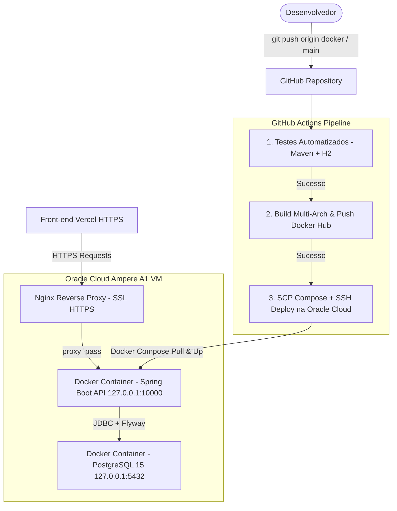

# 📦 Estoque & Gestão — Backend API

[](https://www.oracle.com/java/)
[](https://spring.io/projects/spring-boot)
[](https://www.postgresql.org/)
[](https://flywaydb.org/)
[](https://www.docker.com/)
[](https://www.oracle.com/cloud/)
[](https://github.com/features/actions)

API RESTful desenvolvida em Java 21 e Spring Boot 3 para o gerenciamento de estoque, histórico de movimentações, categorias e caderneta financeira de devedores com baixa automática de produtos. O sistema conta com isolamento multilocatário por usuário, autenticação JWT, proteção contra força bruta, migrações versionadas com Flyway e deploy automatizado na Oracle Cloud.

---

## 🎯 Principais Funcionalidades

### 🔐 **Autenticação, Perfis & Segurança**
- **Autenticação Stateless (JWT):** Geração e validação de tokens HMAC256.
- **Controle de Acesso por Perfil (RBAC):** Separação entre `ROLE_USER` e `ROLE_ADMIN`.
- **Rate Limiting no Login (`LoginAttemptService`):** Bloqueio temporário automático (HTTP `429`) por 15 minutos após 5 tentativas inválidas consecutivas para o mesmo IP + usuário.
- **Conta Root via Ambiente (`AdminBootstrapRunner`):** Criação/promoção automática do administrador inicial via `ADMIN_USERNAME` e `ADMIN_PASSWORD`. Cadastro público fechado (`POST /auth/register` restrito a `ROLE_ADMIN`).
- **Gestão de Perfil Próprio (`/auth/me`):** Consulta e atualização de nome e senha pelo usuário autenticado.
- **Proteção HTTP & CORS:** Cabeçalhos de segurança (`X-Content-Type-Options`, `X-Frame-Options: DENY`, `Referrer-Policy`) e CORS configurável via `CORS_ALLOWED_ORIGINS`.

### 📦 **Produtos & Movimentações de Estoque**
- **CRUD Completo de Produtos:** Cadastro (com preço, estoque mínimo e categoria), atualização, consulta e exclusão isolados por usuário.
- **Status Dinâmico & Filtros:** Endpoints dedicados para produtos com estoque baixo (`/product/lowStock`), sem estoque (`/product/noStock`), pesquisa por nome e sumário agregado (`/product/summary`).
- **Histórico de Movimentações (`/product/movements`):** Registro das entradas e saídas recentes de estoque.

### 🏷️ **Categorias de Produtos**
- **Organização por Categoria:** Associação de produtos a categorias personalizadas com pesquisa por nome e validação de unicidade/integridade.

### 💰 **Caderneta de Devedores (Financeiro)**
- **Controle de Contas a Receber & Baixa de Estoque:** Cadastro de devedores com suporte a vínculo e baixa automática de itens do estoque.
- **Abatimento Parcial e Quitação (`PATCH /{id}/pay` e `PATCH /{id}/settle`):** Registro de pagamentos parciais ou quitação integral preservando o histórico.
- **Extrato Completo de Transações (`/debtor/transactions` e `/debtor/{id}/transactions`):** Consulta às movimentações financeiras recentes e extrato detalhado por cliente.
- **Filtros & Sumário:** Pesquisa por nome/status de quitação (`paid`) e totalizador em tempo real (`/debtor/summary`).

---

## 🛠️ Tecnologias e Ferramentas

| Categoria | Tecnologia | Descrição |
|---|---|---|
| **Linguagem** | Java 21 (Temurin LTS) | Recursos modernos da linguagem Java |
| **Framework** | Spring Boot 3.3.2 | API RESTful, validação (`Bean Validation`) e exceções padronizadas |
| **Segurança** | Spring Security + Auth0 JWT (4.5.0) | Autenticação stateless, BCrypt e RBAC |
| **Persistência & Migrações** | Spring Data JPA + Hibernate + Flyway | Mapeamento relacional com `ddl-auto=validate` e scripts `V1`..`V3` |
| **Banco de Dados** | PostgreSQL 15 & H2 (Testes) | Banco relacional em produção e banco em memória isolado nos testes |
| **Mapeamento** | MapStruct + Lombok | Conversão entre entidades e DTOs |
| **Documentação** | Springdoc OpenAPI 3.0 / Swagger UI | Documentação OpenAPI (habilitável via `SWAGGER_ENABLED=true`) |
| **Containers** | Docker Multi-stage & Docker Compose | Build multi-arch (`amd64`/`arm64`), healthcheck e rotação de logs |
| **CI/CD** | GitHub Actions | Testes automatizados (PRs e push) → Build/Push Docker Hub → Deploy via SSH |
| **Infraestrutura** | Oracle Cloud (Ampere A1 ARM64) + Nginx | Reverse proxy com SSL/TLS (Let's Encrypt via DuckDNS) |

---

## 🏛️ Arquitetura e Pipeline de CI/CD



---

## 📋 Endpoints da API

Quando habilitado localmente (`SWAGGER_ENABLED=true`), o Swagger UI fica disponível em `/swagger-ui/index.html`.

### 🔑 Autenticação e Perfil (`/auth`)
- `POST /auth/login` — Autentica usuário e retorna Token JWT (com rate limit).
- `POST /auth/register` — Cadastra um novo usuário (*requer `ROLE_ADMIN`*).
- `GET /auth/me` — Retorna os dados do usuário autenticado.
- `PUT /auth/me` — Atualiza nome e/ou senha do usuário autenticado.

### 📦 Produtos (`/product`) — *Requer `ROLE_USER`*
- `GET /product` — Lista todos os produtos do usuário logado.
- `GET /product/{id}` — Busca um produto pelo ID.
- `GET /product/pesquisar?name={nome}` — Pesquisa produtos por nome.
- `GET /product/lowStock` — Lista produtos com estoque baixo.
- `GET /product/noStock` — Lista produtos sem estoque.
- `GET /product/summary` — Retorna contadores agregados de produtos.
- `GET /product/movements` — Lista as últimas movimentações de estoque.
- `POST /product` — Cadastra um novo produto.
- `PUT /product/{id}` — Atualiza os dados de um produto.
- `DELETE /product/{id}` — Remove um produto.

### 🏷️ Categorias (`/category`) — *Requer `ROLE_USER`*
- `GET /category` — Lista todas as categorias do usuário.
- `GET /category/{id}` — Busca uma categoria pelo ID.
- `GET /category/pesquisar?name={nome}` — Pesquisa categoria por nome.
- `POST /category` — Cadastra uma nova categoria.
- `PUT /category/{id}` — Atualiza uma categoria.
- `DELETE /category/{id}` — Exclui uma categoria.

### 💰 Devedores (`/debtor`) — *Requer `ROLE_USER`*
- `GET /debtor` — Lista todos os devedores do usuário.
- `GET /debtor/{id}` — Busca um devedor pelo ID.
- `GET /debtor/pesquisar?name={nome}&paid={false|true}` — Lista devedores filtrados por nome e quitação.
- `GET /debtor/summary` — Retorna o valor total devido e quantidade de devedores.
- `GET /debtor/transactions` — Lista as últimas movimentações da caderneta.
- `GET /debtor/{id}/transactions` — Lista o extrato completo de um devedor.
- `POST /debtor` — Cadastra um novo devedor (com suporte a baixa de itens do estoque).
- `PUT /debtor/{id}` — Atualiza os dados do devedor.
- `PATCH /debtor/{id}/pay` — Registra pagamento parcial ou quitação.
- `PATCH /debtor/{id}/settle` — Quita integralmente a dívida preservando o histórico.
- `DELETE /debtor/{id}` — Remove um devedor.

### 👤 Usuários (`/users`) — *Requer `ROLE_ADMIN`*
- `GET /users` — Lista todos os usuários cadastrados.
- `PUT /users/{id}` — Atualiza informações de um usuário.
- `DELETE /users/{id}` — Remove um usuário.

---

## 💻 Como Executar Localmente

### Pré-requisitos
- **Java 21 JDK** e **Maven 3.9+** (ou `./mvnw`).
- **Docker & Docker Compose**.

### Rodando com Docker Compose (Recomendado)

1. **Clone o repositório e configure as variáveis de ambiente:**
   ```bash
   git clone https://github.com/Savio-Marques/estoque-backend.git
   cd estoque-backend
   cp .env.example .env
   ```
2. **Preencha o `.env` e suba o PostgreSQL e a API:**
   ```bash
   docker compose up -d
   ```

A API estará acessível em `http://localhost:10000`.

### Rodando via Maven (Desenvolvimento)

```bash
./mvnw spring-boot:run
```

---

## 🧪 Testes Automatizados

Executa toda a suíte de testes unitários e de integração (com H2 em memória):

```bash
./mvnw test
```

---

## ✒️ Autor

Desenvolvido por **Sávio Marques de Souza**.

- **GitHub:** [@Savio-Marques](https://github.com/Savio-Marques)
- **LinkedIn:** [Sávio Marques](https://www.linkedin.com/in/savio-marques/)
